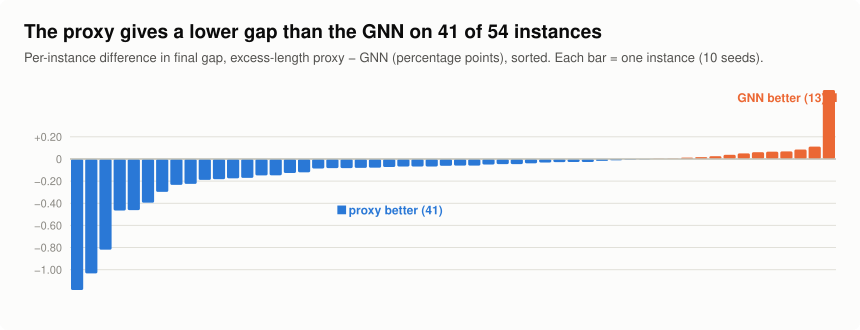
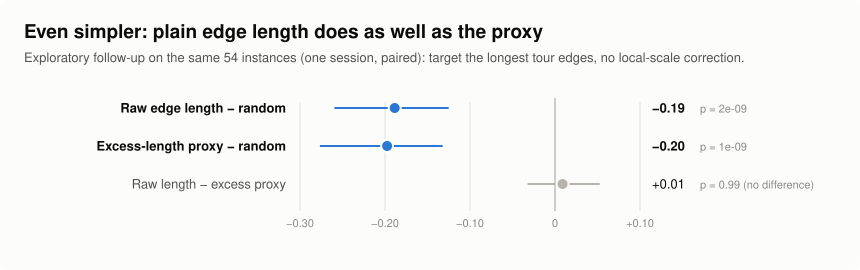
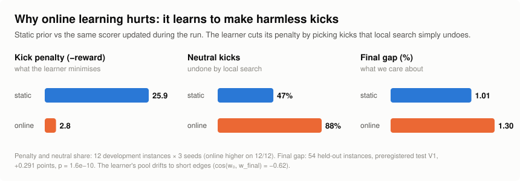
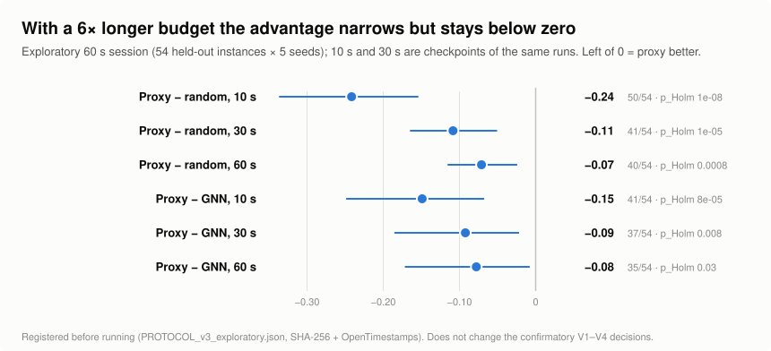

# Do you need to learn where to kick? Kick targeting in fast ILS for the TSP

[](https://doi.org/10.5281/zenodo.24347381)

<picture>
  <source media="(prefers-color-scheme: dark)" srcset="docs/hero_dark.svg">
  
</picture>

**In one line:** aim the double-bridge kick at long tour edges. It is free and needs no training. It does
as well as a GNN trained on LKH-3 tours, in a preregistered test on 54 held-out instances.

| | |
|---|---|
| **Takeaway for practitioners** | Rank tour edges by length (or by length minus the local neighbour scale) and draw kick cut points from the top 6%. This costs O(1) per edge and needs no model. |
| **Evidence** | Preregistered protocol, frozen with SHA-256 and timestamped on Bitcoin (OpenTimestamps, block 976258) before the run. 54 untouched instances × 10 seeds × 8 strategies. All four hypotheses confirmed. A second registered block (segment kick, 60 s budget, pool rule) checks robustness. |
| **Lesson** | Learning *during* the run backfired: the learner optimised a myopic reward and drifted to harmless kicks. |
| **Paper** | Ufuk ASIL, *Vuruşları Hedeflemek İçin Öğrenmek Gerekir mi? Hızlı İteratif Yerel Aramada Eğitimsiz Kenar Uzunluğu Vekillerinin Ön-Kayıtlı Sınaması*, submitted to *Journal of Combinatorial Optimization*. |

---

## 1. What is being compared

Iterated local search (ILS) alternates a local search (here 2-opt + Or-opt, numba) with a **kick**: a
double-bridge move that cuts the tour at 4 points and reconnects it. Classic ILS picks the 4 cut points at
random. *Kick targeting* draws them, with probability `prob`, from a **pool** of the `m = max(12, frac·n)`
most suspicious tour edges. The strategies differ only in how "suspicious" is scored:

| Signal | Training | Cost per edge | Idea |
|---|---|---|---|
| Random | none | – | baseline |
| kNN rank | none | O(1) | edge to a far neighbour rank is suspicious |
| **Excess-length proxy** | none | O(1) | `d(u,v) − (dref(u)+dref(v))/2`, where `dref` is the mean distance to the 1st/2nd nearest neighbour |
| **Raw edge length** (exploratory) | none | O(1) | `d(u,v)`: guided local search's utility without penalties |
| GNN | LKH-3 tours (n 101–400) | model inference | predicts edges not in a near-optimal tour |
| MLP (membership / gain) | LKH-3 tours / kick outcomes | small MLP | per-edge features |
| Static linear prior | fitted offline | O(1) | linear score on the same features |
| Online learner | **during the run** | ridge update | Thompson-sampled ridge regression on per-kick reward |

All strategies share the start tour, the kick random numbers and the wall-clock budget (10 s).
They are therefore paired: each instance-seed pair is a matched comparison.

## 2. The trained model is not needed

<picture>
  <source media="(prefers-color-scheme: dark)" srcset="docs/per_instance_dark.svg">
  
</picture>

The preregistered claim against the GNN is **non-inferiority** (margin 0.05 points). It passed with
p = 7.9e−9. That the proxy is *better* on most instances is an exploratory finding. The gains concentrate
on clustered and real instances (VLSI, national). On uniform random instances, targeting adds little,
because edge lengths there carry little information.

## 3. Even simpler: plain edge length

<picture>
  <source media="(prefers-color-scheme: dark)" srcset="docs/length_arm_dark.svg">
  
</picture>

A follow-up arm (exploratory, run after the confirmatory test) targets the longest tour edges with no
local-scale correction. It reaches the same level as the excess proxy. This suggests the signal is the
edge length itself. Absence of a difference is not proof of equivalence: the 95% CI is [−0.03, +0.05].

## 4. Why online learning hurts, and how to fix it

<picture>
  <source media="(prefers-color-scheme: dark)" srcset="docs/online_dark.svg">
  
</picture>

The online learner is rewarded by the immediate cost change of each kick. Most kicks are repaired by local
search, so the cheapest way to raise the reward is to cut short edges that local search restores at
once. The learner does exactly that: its weights reverse relative to the prior, with cosine −0.62.
The design lesson is that a reward for sparse-improvement search should be tied to *accepted
improvements*, and that a learner's own reward must be monitored together with final quality.
A registered follow-up (section 6) tested exactly this on the held-out set. With credit `max(0, r)` or
`1[accepted]` the harm disappears on 54 of 54 instances, and the learner matches the static prior; it
does not beat it.

## 5. Robustness checks, registered before running

After the confirmatory test, three more sessions were frozen in `PROTOCOL_v3_exploratory.json` (SHA-256 +
OpenTimestamps) *before* they were run. They are exploratory and cannot change V1–V4.

| Question | Result (54 held-out instances) |
|---|---|
| Is a targeted kick better than the classic **segment** (local double-bridge) kick? | Yes: targeted global kick −1.04 points vs random segment kick (51/54, p_Holm = 1e−9). In this engine the segment kick is worse than the random global kick (+0.78). |
| Does the advantage survive a **6× longer budget** (60 s)? | It narrows but stays: −0.07 vs random (p_Holm = 8e−4), −0.08 vs GNN (p_Holm = 0.03; CI upper bound −0.008). |
| Was the pool rule over-tuned on development data? | No: 3 of 4 neighbouring rules also beat random clearly; only *small pool + always target* hurts, as on the development grid. |
| When does targeting help? | The more clustered the instance (CV of nearest-neighbour distance), the larger the gain (Spearman ρ = −0.56); no relation with n. |

<picture>
  <source media="(prefers-color-scheme: dark)" srcset="docs/budget_dark.svg">
  
</picture>

## 6. Reviewer-driven checks: a published model, equal kicks, LKH-3

Five more sessions were frozen in `PROTOCOL_v4_exploratory.json` (SHA-256 + OpenTimestamps) before they
were run. The competitors are the authors' own code: NeuroLKH (official repository and pretrained model,
unchanged) and LKH-3.0.13 with a one-file kick patch (see `third_party/README.md`). Gain-MLP and NeuroLKH
were tuned on the same development grid with the same selection rule as the proxy. All results are
exploratory and cannot change V1–V4.

| Question | Result (54 held-out instances; negative = first term better) |
|---|---|
| Does the proxy keep up with a **published learned model** (NeuroLKH)? | GPU time charged to the 10 s budget: proxy −0.098, not significant (p_Holm = 0.58). Not charged: means equal (+0.009), but NeuroLKH is ahead on 37/54 instances (median 0.066 points, p_Holm = 0.034). |
| Is the proxy's lead a **cost effect**? (20 000 kicks each, model time not counted) | Yes. Every signal beats random by 0.22–0.30 points; the proxy ties the GNN (−0.004), gain-MLP and NeuroLKH are slightly ahead (not significant), and the untrained kNN rank is best per kick (+0.088 vs proxy, p_Holm = 0.011). |
| Does tuning the gain-MLP change V4? | No: tuned vs default −0.013; proxy vs tuned −0.070 (p_Holm = 0.026). |
| Is the online learner's harm caused by its **credit**? | Yes: `max(0, r)` and `1[accepted]` remove it (−0.39 and −0.34 vs signed reward, 54/54). |
| Does the result depend on **arm order or parallel workers**? | One worker, random order: proxy still below random (−0.093, CI below zero; 2 seeds, not significant after Holm). The first arm in a batch kicks about 18% slower; the confirmatory run rotated the order across seeds. |
| Does targeting help inside **LKH-3**? | No: targeted vs random kick +0.001 (30/54, p_Holm = 0.59). The findings hold for fast 2-opt/Or-opt ILS, not for LK-level search. |

The first LKH run had an execution defect (CRLF line ends in the task list kept the targeted arm from
starting). All three arms were re-run with the registered files unchanged; the defect and the fix are in
`PROTOCOL_DEVIATIONS.log`.

## 7. How the evidence was protected

1. **Development:** all choices (signals, pool rule `frac`/`prob`, margin) were made on development
   sets only (`results/kick_targeting/dev_*`).
2. **Freeze:** `PROTOCOL_v2.json` fixes strategies, seeds, hypotheses V1–V4, test order and analysis
   command. It also records the SHA-256 of every code, model and data file it depends on
   (`code_and_data_sha256`).
3. **Timestamp:** `PROTOCOL_v2.json.ots` proves the file existed before the run (Bitcoin block 976258).
   The planned OSF upload was unavailable; the switch was logged *before* the run in
   `PROTOCOL_DEVIATIONS.log`.
4. **Confirm:** a single run on 54 never-touched instances (`holdout2_10s/`, 540 files), analysed once
   with the frozen command. Fixed-sequence testing: V1 online > static, V2 proxy < random,
   V3/V4 proxy non-inferior to GNN / gain-MLP. All rejected H0.
5. **Exploratory work** (the raw-length arm, mechanism analyses, Hodges–Lehmann estimates) is logged as
   such and never changes the confirmatory decisions. The robustness block of section 5 has its own frozen
   protocol (`PROTOCOL_v3_exploratory.json`, `.sha256`, `.ots`); its interruption and restart are logged too.
   The same holds for the reviewer-driven block of section 6 (`PROTOCOL_v4_exploratory.json`).

```bash
cd results/kick_targeting
sha256sum PROTOCOL_v2.json            # 96eb1d9e0f21ead9a513894359ac66cbceb39754a72b564ac667b3a369738085
pip install opentimestamps-client && ots verify PROTOCOL_v2.json.ots
```

Git stores every file byte-for-byte (`.gitattributes`), so the registered hashes hold in a fresh clone.

## 8. Reproduce

```bash
python -m pip install -r requirements.txt               # Python 3.13, numpy, scipy, numba
python -m pytest test_fast_ils.py test_online_reward.py # 9 tests
python v2_analysis.py confirm --tag holdout2_10s        # confirmatory result from the stored runs (seconds)
python scripts/verify_paper_numbers.py                  # recompute headline numbers, check them against the evidence ledger
python readme_figures.py                                # the figures above (writes to release_meta/docs/ in the author's tree)
```

To re-run the experiments (about 4.5 h on 4 cores), use `results/kick_targeting/run_v2_holdout2.ps1`
and `results/kick_targeting/run_v3_length.ps1`; the robustness block (about 7.5 h) is
`results/kick_targeting/run_v4_robustness.ps1`, analysed by `results/kick_targeting/analysis_v4_robustness.py`.
The reviewer-driven block (about 15 h on 4 cores, Docker for LKH-3) is `results/kick_targeting/run_v5.ps1`, analysed by
`results/kick_targeting/analysis_v5.py`; NeuroLKH scores can be reused from `results/kick_targeting/neurolkh_scores/`
without a GPU. The budget is wall-clock time, so other hardware gives close but not identical gaps.

To rebuild the paper's numbers, tables and PDF, run
`python makale_workspace/gnn-crine-ils-joco/evidence/scripts/build_v3.py` (and `build_v4.py`, `build_v5.py`), then
`xelatex main && bibtex main && xelatex main && xelatex main` in `makale_workspace/gnn-crine-ils-joco/paper/`.
Every paragraph carries a `% kaynak: E…` comment listing the records in `evidence/evidence.json` behind its
numbers; each record names its source file and field.

## Repository layout

| Path | Content |
|---|---|
| `fast_ils.py`, `test_fast_ils.py` | ILS engine with targeted double-bridge kicks |
| `v2_targeting_experiment.py`, `v2_analysis.py` | Stage 3 driver and preregistered analysis |
| `v3_extra_experiment.py`, `results/kick_targeting/analysis_length_arm.py` | raw-length arm |
| `v4_robustness_experiment.py`, `results/kick_targeting/analysis_v4_robustness.py` | robustness block (segment kick, 60 s, pool rule) |
| `online_targeting.py`, `analysis_online_*.py`, `test_online_reward.py` | online learner and its mechanism |
| `v5_experiment.py`, `online_credit.py`, `results/kick_targeting/analysis_v5.py` | reviewer-driven block (equal kicks, credit variants, NeuroLKH arm) |
| `neurolkh_prep.py`, `neurolkh_infer.py`, `lkh_b3_experiment.py`, `third_party/` | NeuroLKH input/inference, LKH-3 driver and kick patch |
| `gnn_trained.py`, `cheap_scorer.py`, `models/`, `gnn_train_torch.py` | trained scorers and training code |
| `kick_targeting_experiment.py` | Stage 2 (PROTOCOL v1, 38 VLSI instances) |
| `holdout2_suite.py`, `data_holdout2/` | the 54-instance confirmatory set |
| `data*/` | Waterloo VLSI, National TSP and TSPLIB instances; synthetic suites |
| `results/kick_targeting/` | protocols, deviation log, one JSON per (instance, seed) run |
| `results/*.json` | Stage 1 records (an earlier, withdrawn claim; reported briefly in the paper) |
| `makale_workspace/gnn-crine-ils-joco/` | paper sources (Springer `sn-jnl`), evidence ledger, generators |
| `readme_figures.py`, `make_release.py` | README figures; rebuilds this package |

## Scope and limits

Confirmatory results hold for this engine (2-opt + Or-opt), a 10 s budget and n up to about 10k; the
exploratory blocks extend the budget to 60 s, add the segment kick (window W = 50), a published learned
model (NeuroLKH) and LKH-3. Inside LKH-3 targeting had no measurable effect, so the findings are specific to
fast ILS with a comparatively weak local search. Budgets of minutes and a confirmatory test of proxy vs
kNN rank vs NeuroLKH are the natural next steps.

## License and citation

Code: MIT (`LICENSE`). Third-party benchmark instances keep their original terms. See
`CITATION.cff`. Archived on Zenodo: [10.5281/zenodo.24347381](https://doi.org/10.5281/zenodo.24347381) (concept DOI, resolves to the latest version).
